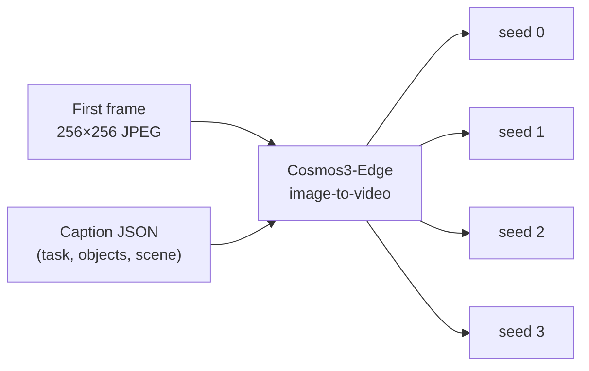
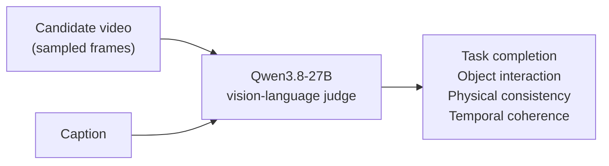
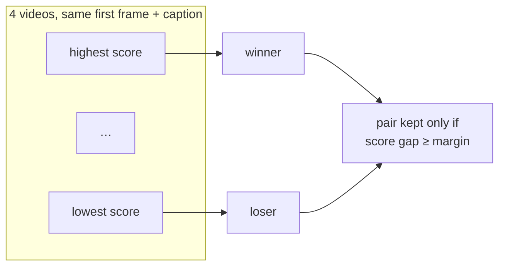
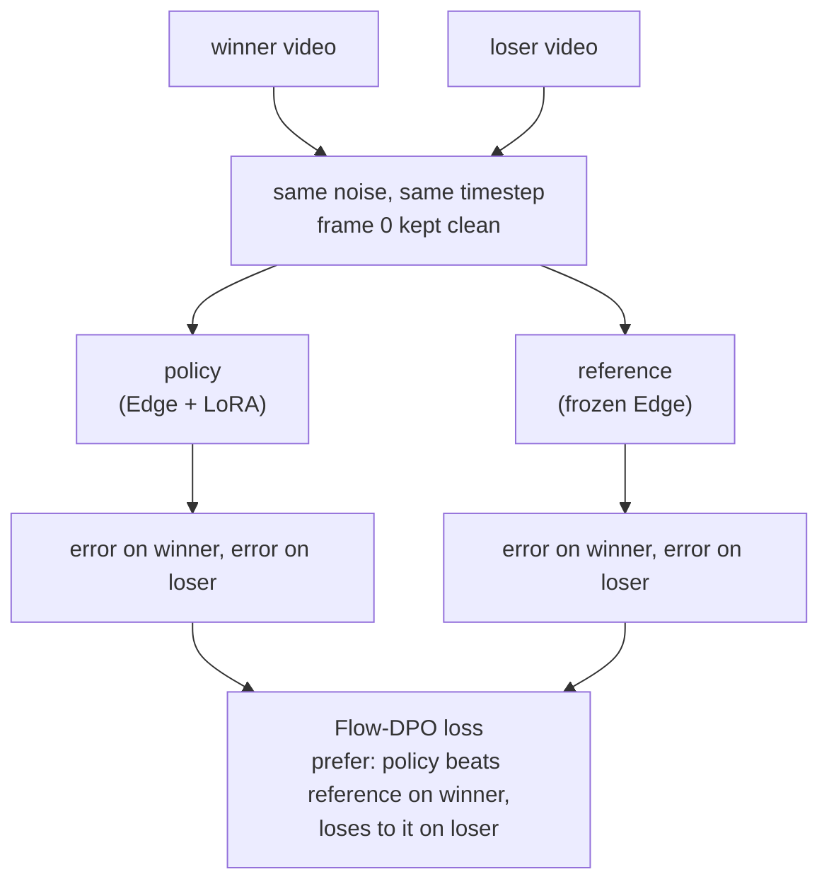
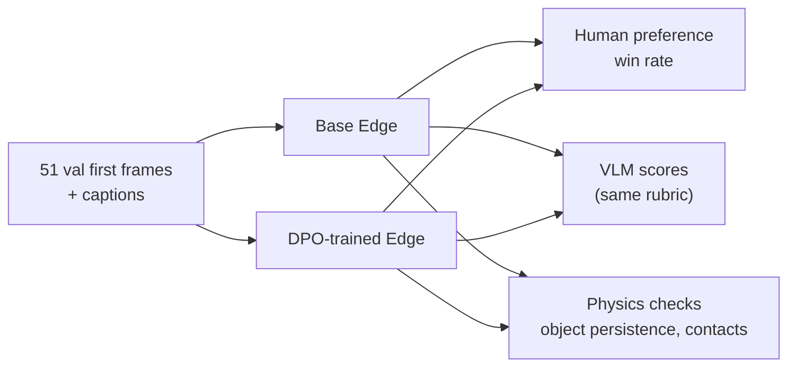

# VLM-Guided Flow-DPO for a Video World Model

Post-training **NVIDIA Cosmos3-Edge (4B)** to generate more physically consistent robot-manipulation
videos, using preferences produced by a **Qwen3.8-27B vision-language judge** instead of human labels.

> **Research question.** Can VLM-guided preference optimization (Flow-DPO) improve a pretrained
> video world model on robot manipulation, without any supervised fine-tuning stage?

| Component | Choice |
|---|---|
| Video generator | [nvidia/Cosmos3-Edge](https://huggingface.co/nvidia/Cosmos3-Edge) (4B, image-to-video) |
| VLM judge | [Qwen/Qwen3.8-27B](https://huggingface.co/Qwen/Qwen3.8-27B) (loaded 4-bit) |
| Dataset | [nvidia/BridgeData2-Subset-Synthetic-Captions](https://huggingface.co/datasets/nvidia/BridgeData2-Subset-Synthetic-Captions) |
| Training | Flow-DPO from [NVIDIA cosmos-framework](https://github.com/NVIDIA/cosmos-framework) (`posttrain.entrypoints.dpo`), LoRA on the generation pathway |
| Hardware | RTX 4090 (24 GB) GPUs |

---

## Pipeline at a glance

Five stages. The base model generates several videos per prompt, a VLM ranks them, the best and worst
become training pairs, and Flow-DPO moves the model toward the winners. Everything is evaluated on clips
the model never saw.


### Why skip SFT

The project plan originally had an SFT stage. It is skipped here on purpose: the question is whether
*preferences alone* can move a pretrained world model, and skipping SFT keeps the frozen reference equal
to the public checkpoint, which makes the comparison clean. SFT can be added back later as an ablation.

---

## Stage by stage

### 1. Generate candidate videos

Each BridgeData2 training clip gives a first frame and a structured caption. The unmodified Cosmos3-Edge
turns that into four videos, one per random seed, all sharing the same starting image and instruction.



1,222 clips × 4 seeds ≈ 4,900 candidate videos. The 51 validation clips are never used here.

### 2. Judge each video with a VLM

Qwen3.8-27B sees sampled frames of a candidate plus the caption and returns four 1–5 scores with a short
rationale each.



| Axis | What the judge looks for |
|---|---|
| Task completion | Does the video show the instruction in the caption being carried out? |
| Object interaction | Does the gripper actually contact and move the right object? |
| Physical consistency | No objects vanishing, teleporting, passing through each other, or melting |
| Temporal coherence | Stable appearance of arm, objects and background across frames |

Judge reliability is measured against a small set of independently annotated clips before the scores are
used for training (planned, see Status).

### 3. Build preference pairs

Within each group of four videos, the highest-scoring one becomes the winner and the lowest the loser.
Groups where the gap is small are discarded because the judge's preference there is noise.



Output is a JSONL manifest with the prompt, winner path, loser path, both scores and the gap, the format
the cosmos-framework DPO dataset reads directly.

### 4. Train with Flow-DPO

Two copies of Cosmos3-Edge take part: a trainable policy with LoRA adapters on the video-generation
pathway, and a frozen reference equal to the original checkpoint. For every pair the same noise is added
to winner and loser, and the loss rewards the policy for denoising the winner better than the reference
does and the loser worse.



Frame 0 is treated as a conditioning frame: it stays clean and is excluded from the loss, so training
matches the image-to-video setting used at inference.

### 5. Evaluate on held-out clips

Base and trained models generate from the same 51 validation first frames with the same seeds, and are
compared three ways.



---

## Repository layout

```
cosmos-align/
├── README.md
├── requirements.txt              # inference / rollout / judge env
├── scripts/
│   └── infer_i2v_val.py          # single-clip image-to-video inference (baseline)
├── outputs/                      # generated videos + metadata JSON (gitignored except samples/)
├── BridgeData2/                  # dataset download (gitignored)
├── models/                       # Cosmos3-Edge, Qwen3.8-27B weights (gitignored)
└── packages/cosmos-framework/    # NVIDIA post-training framework, pinned commit (gitignored, see Setup)
```

---

## Setup

Two environments are needed because NVIDIA's post-training stack pins an older Torch/Transformers than
the Diffusers Cosmos3 pipeline and the Qwen judge require.

### 1. Inference, rollouts, judge (`cosmos` env)

```bash
conda create -n cosmos python=3.12 -y && conda activate cosmos
pip install -r requirements.txt
```

### 2. Weights and data

```bash
# accept the OpenMDW licence on the model page first, then
hf download nvidia/Cosmos3-Edge --local-dir models/Cosmos3-Edge
hf download Qwen/Qwen3.8-27B   --local-dir models/Qwen3.8-27B
hf download nvidia/BridgeData2-Subset-Synthetic-Captions --repo-type dataset --local-dir BridgeData2
```

### 3. Post-training env (Flow-DPO only)

```bash
git clone https://github.com/NVIDIA/cosmos-framework.git packages/cosmos-framework
cd packages/cosmos-framework && git checkout 709ecd9
export UV_PROJECT_ENVIRONMENT="$PWD/.venv-posttrain"
uv sync --frozen --no-default-groups
# Do not use --active here: if your shell has another venv activated, uv will rebuild that one instead.
env -u VIRTUAL_ENV uv sync --project docker/posttrain/environment --frozen --group cu130-runtime \
        --inexact --python .venv-posttrain/bin/python
```

---

## Usage

### Baseline inference on one held-out clip

```bash
conda activate cosmos
CUDA_VISIBLE_DEVICES=0 python scripts/infer_i2v_val.py --clip episode_002345_clip000 --seed 0
```

Reads the clip's upsampled JSON prompt, first frame, resolution, frame count and fps from the dataset's
`inference_prompt_i2v` file, runs the model card's Diffusers recipe, and writes the MP4 plus a JSON with
timing and peak memory to `outputs/base_i2v/`.

---

## Results

### Baseline (Cosmos3-Edge, no fine-tuning)

Measured on one RTX 4090, 256×256, 93 frames at 5 fps, 20 denoising steps, guidance 6.0:

| Metric | Value |
|---|---|
| Generation time | 12.1 s |
| Peak GPU memory | 9.0 GB |
| Model load (cold, NFS) | 75 s |

Qualitatively, the base model keeps the scene and arm stable but tends to **drop objects from the scene**:
in the bead-sweeping clip below most beads vanish within the first few frames and the sweep never gathers
them, while the real video keeps every bead and pushes them into a pile. This object-disappearance /
task-completion failure is exactly what the preference stage targets.

Top: generated. Bottom: ground-truth clip.


### Base vs. Flow-DPO

_Pending. Will report task-completion rate, physical-consistency violation rate, temporal coherence,
human preference win rate with confidence intervals, and VLM–human agreement of the judge._

---

## Status

- [x] Dataset downloaded and verified (1,222 train / 51 val, all splits complete)
- [x] Cosmos3-Edge baseline inference working on a single 24 GB GPU
- [x] Flow-DPO path in cosmos-framework audited: video pairs via JSONL, LoRA support, Edge→DCP converter, i2v conditioning via a custom sequence plan
- [ ] Rollout generation: 4 seeds × 1,222 train first frames
- [ ] Qwen3.8-27B judge (4-bit) with structured 4-axis scores
- [ ] Judge reliability check against independent labels
- [ ] Preference pair construction and filtering
- [ ] Flow-DPO training (Edge model config, LoRA, frozen base reference)
- [ ] Held-out evaluation and ablations (score margin, candidates per prompt, global vs pairwise judging)

---

## Notes and caveats

- **Visual task completion is not robot success.** No claim about policy performance is made unless the
  videos are later tied to executable actions and evaluated in simulation or on hardware.
- The dataset's prompts specify **5 fps**, below the 12–30 fps range listed on the model card. The pipeline
  accepts it, and matching the dataset's native rate was preferred over the documented range.
- The safety checker is disabled during research inference to avoid downloading the guardrail models.

## Acknowledgements

Cosmos3-Edge, the BridgeData2 subset and the cosmos-framework are released by NVIDIA under OpenMDW.
BridgeData V2 is from Walke et al., CoRL 2023. Qwen3.8 is released by the Qwen team under Apache 2.0.
